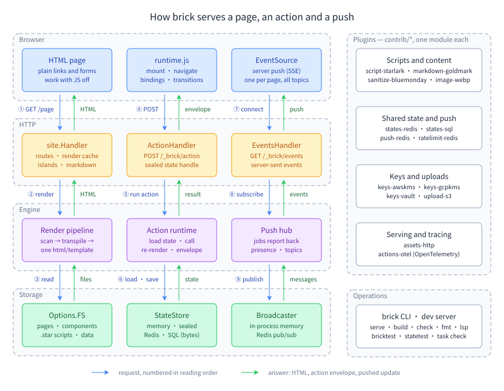

# brick documentation

brick is a component-based HTML render engine for Go, built on `html/template`. This is the map of its documentation: a learning path from your first page to a production setup, a table that starts from the thing you want to do, and every section below that.

New here? Read [Getting started](getting-started.md) (ten minutes, one site, one page, one component, one button), then follow the path.

## The learning path

Twelve steps, in order. Each one teaches a layer, links the guide that builds it, and links a runnable example whose Go test checks the exact output the guide shows. Run any example from the `examples` folder with `go run ./<name>` and its test with `go test ./<name>/`.

| Step | You learn | Guide | Example |
|---|---|---|---|
| 1. First site | install the `brick` command, make a site, a page, a component and a button | [Getting started](getting-started.md) | [components-props](../examples/components-props/) |
| 2. Components and props | tags, typed props with defaults and `oneof`, object props, `{{ attrs }}`, `brick:spread` | [Components and props](guides/components/props.md) | [components-props](../examples/components-props/) |
| 3. Children and slots | `{{ children }}`, named blocks, scoped slots, declared slots, raw bodies | [Children, blocks and slots](guides/components/slots.md) | [components-slots](../examples/components-slots/) |
| 4. Layouts and data | layouts, `.Ctx` with `provide` and `inject`, `.Site`, data files, translations | [Layouts, context, site data and translations](guides/components/layouts-and-data.md) | [components-layouts-data](../examples/components-layouts-data/) |
| 5. Scripts and loaders | Starlark helpers, a component that fetches its own data, batching in a loop, redirects and statuses | [Scripts and loaders](guides/components/loaders.md) | [components-loaders](../examples/components-loaders/) |
| 6. Styles, client code and errors | scoped CSS, client modules, `{{ assets }}`, boundaries and the diagnostics that name a file and line | [Styles and client code](guides/components/styles-and-client.md), [When things go wrong](guides/components/errors.md) | [components-styles-client](../examples/components-styles-client/), [components-errors](../examples/components-errors/) |
| 7. A whole site | files to URLs, markdown, collections, dynamic routes, 404 pages, the dev server, a static export | [Pages, URLs and `.Site.Pages`](guides/site/pages-and-routes.md), [Static export](guides/site/static-export.md) | [site-blog](../examples/site-blog/) |
| 8. Stateful components | `state:`, actions, `$set` and `$toggle`, renderless actions, a counter that lives on the server | [Stateful components and actions](guides/interactivity/stateful-components.md) | [interactivity-counter](../examples/interactivity-counter/) |
| 9. Forms | deferred fields, validation rules declared once, uploads, forms that work without JavaScript | [Deferred fields](guides/forms/deferred-fields.md), [Validation](guides/forms/validation.md), [Uploads](guides/forms/uploads.md) | [forms-signup](../examples/forms-signup/), [forms-uploads](../examples/forms-uploads/) |
| 10. Live updates | effects, events between components, push, presence, background jobs | [Live updates and effects](guides/live/README.md) | [live-effects-events](../examples/live-effects-events/), [live-push-presence](../examples/live-push-presence/) |
| 11. Islands, navigation and URL state | per-visitor parts of a cached page, lazy and streamed islands, navigation without reloads, `query:` fields | [Islands](guides/interactivity/islands-lazy-and-streaming.md), [Navigation](guides/interactivity/navigation.md), [State in the URL](guides/interactivity/url-and-server-state.md) | [interactivity-lazy-stream](../examples/interactivity-lazy-stream/), [interactivity-navigation](../examples/interactivity-navigation/) |
| 12. Production | state stores and sealed state, sessions and sign-out, action middleware and rate limits, the host API, hosting under a path, and tests with `bricktest` | [Production guides](guides/production/README.md), [Testing with bricktest](guides/tooling/bricktest.md) | [production-sealed-state](../examples/production-sealed-state/), [production-middleware](../examples/production-middleware/) |

When a step offers more than one way to do something, the matching [choosing guide](choosing/README.md) compares them.

## Start from your goal

| I want to… | Read | Example |
|---|---|---|
| make my first page and component | [Getting started](getting-started.md) | [components-props](../examples/components-props/) |
| pass markup into a component | [Children, blocks and slots](guides/components/slots.md) | [components-slots](../examples/components-slots/) |
| load data for a component from a database or API | [Scripts and loaders](guides/components/loaders.md) | [components-loaders](../examples/components-loaders/) |
| style a component and ship its JavaScript | [Styles and client code](guides/components/styles-and-client.md) | [components-styles-client](../examples/components-styles-client/) |
| tune component roots, tag spelling and data formats | [Components and props](guides/components/props.md), [Layouts and data](guides/components/layouts-and-data.md) | [components-options](../examples/components-options/) |
| find out why a render failed | [When things go wrong](guides/components/errors.md) | [components-errors](../examples/components-errors/) |
| build a blog or docs site | [Pages, URLs and `.Site.Pages`](guides/site/pages-and-routes.md) | [site-blog](../examples/site-blog/) |
| publish to GitHub Pages or a static host | [Static export](guides/site/static-export.md), [Hosting under a path](guides/site/subpath-and-mount.md) | [site-blog](../examples/site-blog/), [site-subpath](../examples/site-subpath/) |
| serve a site in several languages | [Languages](guides/site/languages.md) | [site-i18n](../examples/site-i18n/) |
| add an RSS feed, robots.txt or a sitemap | [Feeds, robots.txt and the sitemap](guides/site/feeds-and-sitemap.md) | [site-feeds-sitemap](../examples/site-feeds-sitemap/) |
| resize images and serve WebP | [Images](guides/site/images.md) | [site-images](../examples/site-images/) |
| use Tailwind | [Tailwind](guides/site/tailwind.md) | [site-tailwind](../examples/site-tailwind/) |
| make a button change something on the server | [Stateful components and actions](guides/interactivity/stateful-components.md) | [interactivity-counter](../examples/interactivity-counter/) |
| keep a filter in the URL | [State in the URL](guides/interactivity/url-and-server-state.md) | [interactivity-url-state](../examples/interactivity-url-state/) |
| personalise part of a cached page | [Islands, lazy islands and streaming](guides/interactivity/islands-lazy-and-streaming.md), [Protected and per-request pages](guides/site/protected-pages.md) | [site-protected](../examples/site-protected/) |
| navigate between pages without a reload | [Navigation without reloads](guides/interactivity/navigation.md) | [interactivity-navigation](../examples/interactivity-navigation/) |
| build a sign-up form with checks | [Validation](guides/forms/validation.md) | [forms-validation-lists](../examples/forms-validation-lists/) |
| take file uploads | [Uploads](guides/forms/uploads.md) | [forms-uploads](../examples/forms-uploads/) |
| keep forms working with JavaScript off | [Forms without JavaScript](guides/forms/without-javascript.md) | [forms-nojs](../examples/forms-nojs/) |
| flash a message or redirect after an action | [Effects](guides/live/effects.md) | [live-effects-events](../examples/live-effects-events/) |
| refresh every open page when data changes | [Push and presence](guides/live/push-and-presence.md) | [live-push-presence](../examples/live-push-presence/) |
| run a slow job and show the result later | [Background jobs](guides/live/background-jobs.md) | [live-jobs](../examples/live-jobs/) |
| keep state across restarts and servers | [Sealed state](guides/production/sealed-state.md), [State stores](guides/production/state-stores.md) | [production-sealed-state](../examples/production-sealed-state/), [production-state-stores](../examples/production-state-stores/) |
| tie state to a signed-in user | [Sessions and sign-out](guides/production/sessions.md) | [production-sealed-state](../examples/production-sealed-state/) |
| rate-limit and log actions | [Action middleware](guides/production/action-middleware.md) | [production-middleware](../examples/production-middleware/) |
| mount brick in my own Go server | [The Go host API](guides/production/host-api.md) | [production-host-api](../examples/production-host-api/), [engineonly](../examples/engineonly/) |
| test a theme in `go test` | [Testing with bricktest](guides/tooling/bricktest.md) | [tooling-bricktest](../examples/tooling-bricktest/) |
| test my own state store | [statetest](guides/tooling/statetest.md) | [tooling-statetest](../examples/tooling-statetest/) |
| format and lint in my editor, or gate formatting in CI | [Formatting](guides/tooling/fmt.md), [Editors](guides/tooling/editors.md) | [tooling-cli](../examples/tooling-cli/) |
| use a ready-made component set or share my own | [Component libraries](guides/components/libraries.md), [Choosing where components come from](choosing/component-sources.md), [kit](../kit/README.md) | [components-libraries](../examples/components-libraries/), [ui](../examples/ui/) |
| pick between several approaches | [Choosing guides](choosing/README.md) | |

## Every section

### Learn

- [Getting started](getting-started.md): install, a first page, a component and an action.
- The [guide](guide.md): every feature as problem, fix and example, on one long page. Use it to read top to bottom or to search.
- The [cookbook](cookbook.md): real tasks start to finish, with every file and the exact output.

### Choose

The [choosing guides](choosing/README.md) compare the options for one decision each:

- [State store](choosing/state-store.md): memory, sealed, SQL, Redis, your own, and where the key comes from.
- [Interactivity](choosing/interactivity.md): from plain pages to push.
- [Forms](choosing/forms.md): live or deferred fields, no-JavaScript posts, uploads.
- [Rendering and hosting](choosing/rendering-and-hosting.md): static export, dev server, your binary, engine alone.
- [Where components come from](choosing/component-sources.md): your project, a remote file, a library, the kit.

### Guides by topic

Each folder has an index page with what every guide covers and which example it builds.

- [Components and templates](guides/components/README.md): [props](guides/components/props.md), [slots](guides/components/slots.md), [layouts and data](guides/components/layouts-and-data.md), [loaders](guides/components/loaders.md), [component libraries](guides/components/libraries.md), [styles and client code](guides/components/styles-and-client.md), [errors](guides/components/errors.md).
- [Site](guides/site/README.md): [pages and routes](guides/site/pages-and-routes.md), [markdown](guides/site/markdown-and-headings.md), [collections](guides/site/collections-and-drafts.md), [404 pages](guides/site/not-found-and-error-pages.md), [dynamic routes](guides/site/dynamic-routes.md), [protected pages](guides/site/protected-pages.md), [feeds and sitemap](guides/site/feeds-and-sitemap.md), [languages](guides/site/languages.md), [images](guides/site/images.md), [Tailwind](guides/site/tailwind.md), [hosting under a path](guides/site/subpath-and-mount.md), [dev server](guides/site/dev-server.md), [static export](guides/site/static-export.md), [render cache](guides/site/render-cache.md).
- [Interactivity](guides/interactivity/README.md): [stateful components](guides/interactivity/stateful-components.md), [URL and server state](guides/interactivity/url-and-server-state.md), [events and modifiers](guides/interactivity/events-and-modifiers.md), [islands](guides/interactivity/islands-lazy-and-streaming.md), [navigation](guides/interactivity/navigation.md), [morph, transitions and client commands](guides/interactivity/morph-transitions-client-commands.md).
- [Forms](guides/forms/README.md): [deferred fields](guides/forms/deferred-fields.md), [without JavaScript](guides/forms/without-javascript.md), [validation](guides/forms/validation.md), [uploads](guides/forms/uploads.md), [method links](guides/forms/method-links.md).
- [Live updates](guides/live/README.md): [effects](guides/live/effects.md), [events](guides/live/events.md), [rows and regions](guides/live/rows-and-regions.md), [push and presence](guides/live/push-and-presence.md), [background jobs](guides/live/background-jobs.md), [the browser runtime](guides/live/browser-runtime.md).
- [Production](guides/production/README.md): [state stores](guides/production/state-stores.md), [sealed state](guides/production/sealed-state.md), [sessions](guides/production/sessions.md), [action middleware](guides/production/action-middleware.md), [host API](guides/production/host-api.md), [limits and determinism](guides/production/limits-determinism.md).
- [Tooling](guides/tooling/README.md): [fmt](guides/tooling/fmt.md), [editors](guides/tooling/editors.md), [bricktest](guides/tooling/bricktest.md), [statetest](guides/tooling/statetest.md).

### Reference

- [Feature index](reference/features.md): every feature with its guide and an example that uses it.
- [The `brick` command](reference/cli.md): every subcommand, flag and exit code.
- [Frontmatter keys](reference/frontmatter.md): every key a page or component may declare, generated from the code.
- [Attribute reference](reference/attributes.md): every `brick:` attribute, its modifiers and value type.
- [Browser runtime API](reference/runtime-api.md): `window.brick`, its hooks, events and `brick-config` settings.

### Examples and modules

- [Examples](../examples/README.md): one runnable program per feature area, each with a test.
- [The UI kit](../kit/README.md): 133 components and the rules they follow.
- [Contrib modules](../contrib/): Starlark, markdown, sanitizing, S3 uploads, Redis and SQL state stores, KMS and Vault keys, rate limits, OpenTelemetry, push over Redis, WebP.
- [CHANGELOG](../CHANGELOG.md), [CONTRIBUTING](../CONTRIBUTING.md), [SECURITY](../SECURITY.md).
